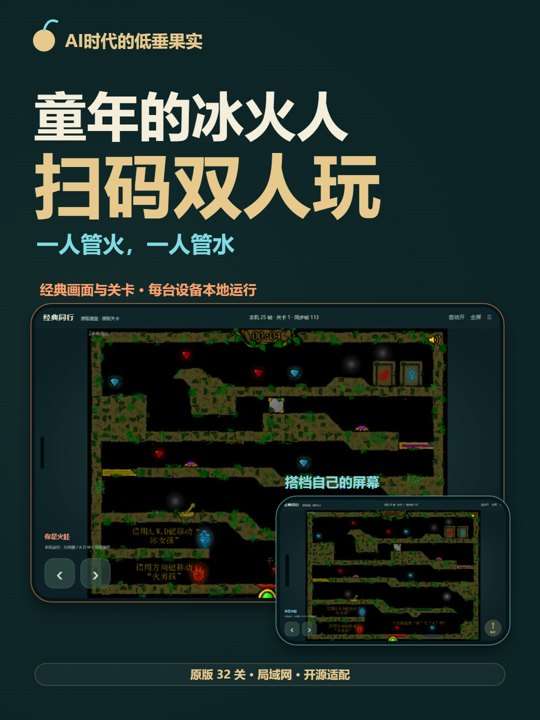

# 经典同行 · Classic SWF Co-op

把经典 SWF 改成「房主开房、搭档扫码、每人控制一个角色」的局域网合作游戏。
当前适配示例为森林冰火人经典版，保留原画面、原物理与 32 个关卡。

**两端都在本地运行游戏，通过 WebSocket 同步有序输入。** 房主不再向搭档串流视频。

0.3.0 恢复原版主菜单、操作说明和选关图，由**玩家1（房主座位，不限火娃/水娃）**操作，搭档同步观看。新增两个角色各自的自动安全检查点：死亡只复活对应角色，已收集宝石和当前机关进度保留。

[下载发布版本](https://github.com/181404010226/classic-swf-coop/releases) · [改造原理](docs/SWF-ADAPTER.md) · [验证记录](verification)

[](https://github.com/181404010226/classic-swf-coop/releases/tag/v0.2.0)

上方演示片为 0.2.0 版本，含电脑双端实际联机录制与标注的手机外框/操作流程示意，中文旁白为 AI 合成。

## 使用

- 房主运行电脑版或 Android 应用，创建双人房。
- 两台设备连接同一 Wi-Fi，或让搭档连接房主热点。
- 搭档扫描二维码用浏览器加入；使用 APK 时可在首页粘贴房间链接。
- 搭档准备后，房主开始，双方进入原版菜单。只有玩家1可以点击开始、说明、选关和返回主菜单；每人进入关卡后控制自己的火娃或水娃。
- PC 使用方向键或 A/D/W、空格；手机支持方向与跳跃多指同时按。
- 从原版选关图选择全部 32 关；玩家1可用右上角菜单重新开始本关，或退出本关回到原版菜单。临时断网、切后台会暂停，回来后自动恢复。
- 两个角色分别在稳定安全地面连续站稳 6 帧（约 0.24 秒）后自动记录安全点。按各角色属性排除危险池，检查支撑宽度、边缘和身体空间，保留最近落脚点历史；当前点被障碍占用时可回退更早落点，没有已记录点则使用出生点。
- 死亡后只复活死亡角色，另一位搭档、宝石和机关继续保留。复活后**先松开方向/跳跃，再继续移动**，防止按住方向反复冲进危险区域。
- 没有搭档时可单机切换两个角色。声音分别在两端播放，可以单独关闭。

Android 8.0+；电脑版需要 Java 17+。原版仍为 25 FPS。
下载、上传或播放视频并不参与游戏联机。

## 公开内容与原版文件

本仓库公开联机壳、Android 容器、房间服务、适配生成脚本、标签保留工具和测试。
原版 SWF 和完整反编译文件不提交进 Git；构建时从你提供的本地文件生成补丁。

- 参考页面：<https://rgm.games/game/141>
- 原文件来源：<https://rgm.games/api/roms/141.swf>
- 该 profile 要求 SHA256：`b971248765587523e63e5264a2e9d00db3e595d9866b2d8c15a403d7dee2aa6b`

原游戏的画面、声音、关卡和代码仍归原权利人；项目自身的 MIT 许可证不覆盖原游戏。
第三方依赖见 [NOTICE](NOTICE)。

## 从源码构建（Windows）

需要 Python 3.12+、JDK 17；构建 APK 还需要 Android SDK platform 35 / build-tools 35.0.1。
浏览器测试需要 Node.js、Playwright 和 Microsoft Edge。下列路径可替换为本机安装路径。

```powershell
git clone https://github.com/181404010226/classic-swf-coop.git
cd classic-swf-coop
npm ci

# 导入你已有的原文件；下载带哈希校验的 FFDec / Ruffle / JSON-java，生成补丁
python tools/prepare.py --game C:/path/to/game.swf --java D:/Java/MicrosoftJDK17/bin/java.exe

# Java 房间协议与输入安全检查
./app/test/run.ps1 -Jdk D:/Java/MicrosoftJDK17

# 生成电脑版，双击 build/desktop/Start.cmd 运行
./tools/build-desktop.ps1 -Jdk D:/Java/MicrosoftJDK17

# 构建 APK。默认生成自己的开发签名，也可传入自己的 -SigningKey
./app/build.ps1 -Jdk D:/Java/MicrosoftJDK17 -Sdk D:/Android/Sdk
```

首次准备需要下载依赖；游戏运行在局域网，开局后不需要互联网。
`local/`、`build/`、APK、密钥、生成的字节码和反编译结果均被 Git 忽略。

## 验证

```powershell
# 终端 A：适配接口实验室
npm run lab
# 终端 B：两个隔离实例，32 关逐帧比较与冷启动
npm run test:determinism
npm run test:startup
npm run test:checkpoints

# 房间联机：先运行 DesktopServer 或电脑版，控制台可见 PORT/HOST
$env:CLASSIC_URL='http://127.0.0.1:17684'
$env:CLASSIC_HOST='控制台输出的 HOST'
npm run test:network
npm run test:touch
```

0.3.0 记录见 [verification/v0.3.0](verification/v0.3.0)：32 关各 300 帧（9,600 对状态比较）；两名角色自然触碰危险后的独立复活、实际收集宝石保留、长按直到松开恢复控制、延迟重放；原版菜单/说明/选关/返回、玩家2点击及接口请求被阻止；真实房间暂停、重连、换关、失步恢复和 750 帧连续联机。另通过 844×390 移动端触屏模拟，验证玩家1选水娃仍可控制原版菜单，多指移动+跳跃、单指释放及反向正常；触屏模拟不是手机实机测试。
0.2.0 曾通过 12 次冷启动，用户随后反馈旧版实测无问题。新版本的验证记录单独保存。性能数据来自电脑 Edge 的本机回环，不是手机触控到屏幕的延迟；本次尚未完成新版手机实机测试、所有关卡逐关人工通关及 Android ARM/x86 长时一致性矩阵。

## 架构与边界

```text
本地 SWF A  ← 同一关卡 / 种子 / 输入帧 →  Java 房间服务  ← 输入帧 →  本地 SWF B
原版渲染与物理                         25 Hz 排序、日志、校验        原版渲染与物理
```

- 原版物理步长保持 1/26 秒，求解 50 次；同步帧为 40 ms。
- 每 10 帧比较状态摘要；临时断线或失步后重建并重放确认输入。
- 350 ms 按键租约、输入序号、关卡与恢复代次检查防止旧输入或丢失松键。
- 日志上限每关一小时；关闭房主服务会结束房间，进度暂不持久化。
- 目前没有本地预测或快照回滚，弱网仍会产生等待，长关卡的重放需要时间。
- `rgm141-lan/2` 是游戏专用适配器；菜单与关卡跳转由服务端验证玩家1权限；检查点历史、复活次数与输入释放锁参与摘要和回放。其他 SWF 需找到各自的时钟、随机数、状态与关卡入口。

## 目录

```text
app/src/         Android 容器与 Java 房间服务
app/assets/      网页房间、触屏输入与 Ruffle 桥接（运行时由 prepare 获取）
app/test/        房间协议和真实双客户端测试
tools/           可复现准备、AS3 适配生成、菜单/检查点模块与实验室
docs/            改造经验和复用边界
verification/    已完成测试与文件完整性记录
```
